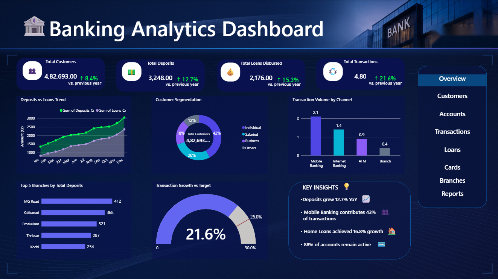

# 🏦 Banking Analytics Dashboard

An interactive **Power BI** dashboard that gives a one-page view of a bank's customers, deposits, loans, transactions and branch performance. It is built to help management track growth, spot top-performing branches and channels, and monitor progress against targets.



---

## 📌 Project Overview

Banks generate large volumes of customer, account and transaction data every day. This project turns that data into a clear, visual dashboard so decision-makers can quickly answer questions like:

- How are customers, deposits and loans growing year over year?
- Which channels (Mobile, Internet, ATM, Branch) drive the most transactions?
- Which branches hold the highest deposits?
- Are transactions on track against the growth target?

---

## 📊 Key Metrics (KPIs)

| KPI | Value | vs. Previous Year |
|---|---|---|
| Total Customers | 4,82,693 | ▲ 8.4% |
| Total Deposits | 3,248 | ▲ 12.7% |
| Total Loans Disbursed | 2,176 | ▲ 15.3% |
| Total Transactions | 4.80 | ▲ 21.6% |

---

## 📈 Dashboard Visuals

- **Deposits vs Loans Trend:** monthly area/line chart comparing deposits and loans across the year
- **Customer Segmentation:** donut chart (Individual 42%, Salaried 28%, Business 18%, Others 12%)
- **Transaction Volume by Channel:** column chart (Mobile Banking, Internet Banking, ATM, Branch)
- **Top 5 Branches by Total Deposits:** MG Road, Kakkanad, Ernakulam, Thrissur, Kochi
- **Transaction Growth vs Target:** gauge showing 21.6% growth against a 25% target
- **Key Insights panel:** quick business takeaways
- **Navigation menu:** Overview, Customers, Accounts, Transactions, Loans, Cards, Branches, Reports

---

## 💡 Key Insights

- Deposits grew **12.7% YoY**
- **Mobile Banking contributes 43%** of all transactions
- **Home Loans achieved 16.8% growth**
- **88% of accounts** remain active
- Transaction growth (21.6%) is close to, but still below, the 25% target

---

## 🛠️ Tools & Technologies

- **Power BI Desktop:** data modelling, DAX, visuals
- **Power Query:** data cleaning and transformation
- **DAX:** KPI and growth measures
- **Excel / CSV:** source data
- **SQL / Python (optional):** data preparation

---

## 🧮 Sample DAX Measures

```DAX
Total Customers = DISTINCTCOUNT(Customers[CustomerID])

Total Deposits = SUM(Accounts[Deposit_Cr])

Total Loans = SUM(Loans[Loan_Amount_Cr])

Total Transactions = COUNTROWS(Transactions)

Deposits YoY % =
VAR CurrentYear = [Total Deposits]
VAR PreviousYear =
    CALCULATE([Total Deposits], SAMEPERIODLASTYEAR('Date'[Date]))
RETURN
    DIVIDE(CurrentYear - PreviousYear, PreviousYear)

Mobile Banking Share % =
DIVIDE(
    CALCULATE([Total Transactions], Transactions[Channel] = "Mobile Banking"),
    [Total Transactions]
)
```

> Update table and column names to match your own data model.

---

## 📁 Repository Structure

```
Banking-Analytics-Dashboard/
│
├── BankingDashboard.pbix      # Power BI report file
├── data/                      # Dataset files (CSV / Excel)
├── images/                    # Dashboard screenshots
│   └── dashboard-overview.png 
└── README.md
```

---

## 🚀 How to Use

1. Clone or download this repository.
2. Open `BankingDashboard.pbix` in **Power BI Desktop**.
3. If prompted, update the data source path under **Transform data → Data source settings**.
4. Click **Refresh** to load the data and explore the dashboard.

---

## 🎯 Skills Demonstrated

Data cleaning · Data modelling · DAX · KPI design · Dashboard design · Business storytelling

---

## 👤 Author

**Sethu Santhosh**
Aspiring Data Analyst | B.Com Computer Applications
Skills: SQL, Excel, Power BI, Python

📧 Connect with me on [LinkedIn](https://www.linkedin.com/) · [GitHub](https://github.com/sethusanthosh-analyst)

---

⭐ If you found this project useful, please give it a star!
