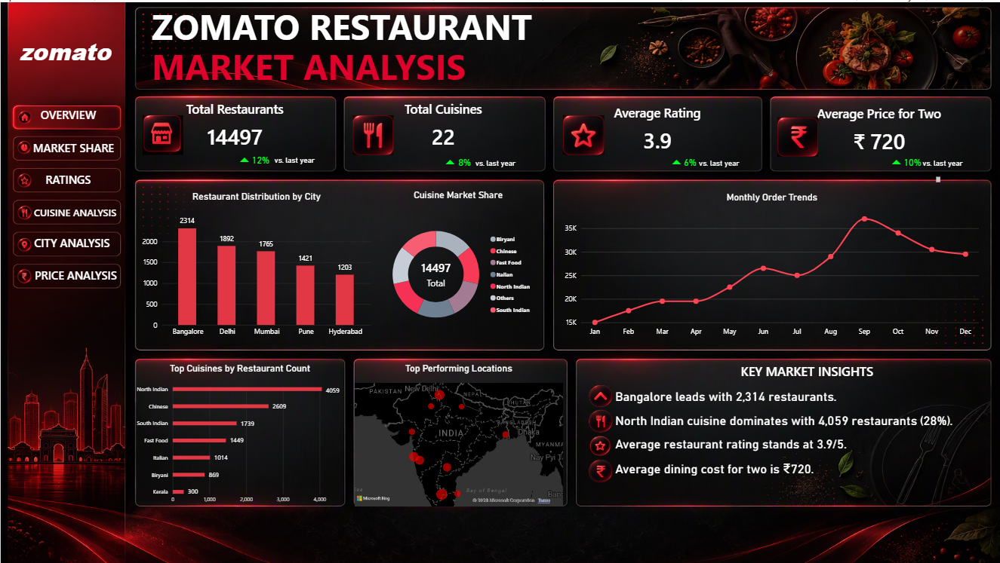

# Zomato Restaurant Market Analysis | Excel & Power BI

## Project Overview
This project explores restaurant data to uncover insights about restaurant distribution, cuisine popularity, customer ratings, pricing patterns, and monthly order trends across major Indian cities.

The dashboard was developed using Microsoft Excel and Power BI to transform raw data into meaningful business insights.

## Dashboard Preview

## Objectives
- Analyze restaurant distribution across cities.
- Identify popular cuisines and cuisine market share.
- Evaluate restaurant ratings.
- Analyze average dining costs.
- Explore monthly order trends.
- Present findings through an interactive dashboard.

## Key Insights
- Analyzed 14,497 restaurant records.
- Examined 22 cuisines.
- Bangalore leads with 2,314 restaurants.
- North Indian cuisine accounts for 28% of the restaurant share.
- Average restaurant rating is 3.9/5.
- Average price for two is ₹720.
- September recorded the highest monthly order volume.

## Tools Used
- Microsoft Excel
- Power BI
- Power Query
- DAX

## Skills Demonstrated
- Data Cleaning
- Data Transformation
- Data Modeling
- Data Visualization
- KPI Development
- Business Insight Generation

## Files Included
- Power BI dashboard (.pbix)
- Excel dataset (.xlsx)
- Dashboard screenshot (.png)

## Dataset Disclaimer
This project uses synthetic data created for portfolio and educational purposes. It is not official Zomato data.
